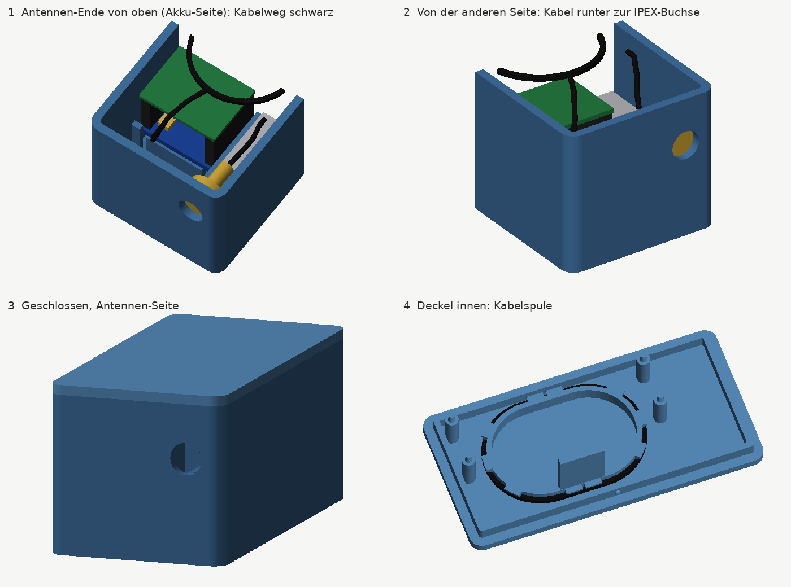
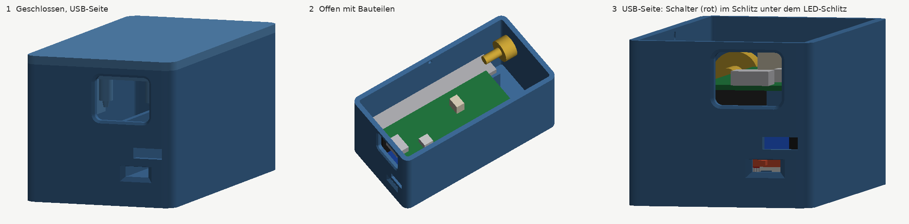
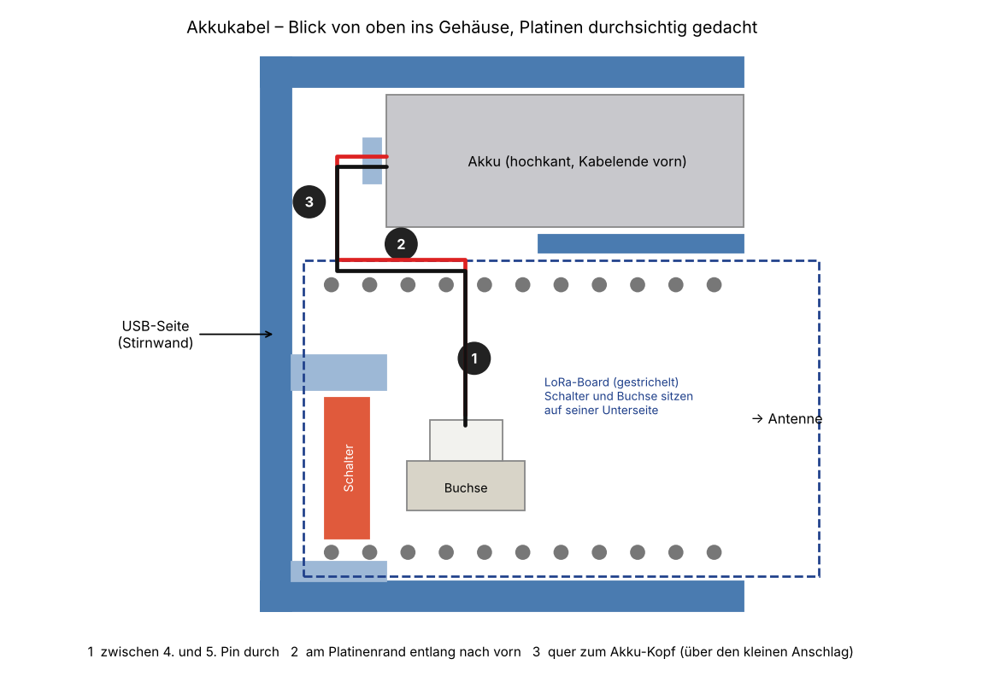

# Pico-2W-LoRa-Case

3D-druckbares Gehäuse für einen **Raspberry Pi Pico 2 W** mit dem **Waveshare Pico-LoRa-SX1262** und LiPo-Akku. Es hat Öffnungen für USB, Ein/Aus-Schalter, Status-LEDs und eine SMA-Antennenbuchse sowie eine Kabelspule im Deckel für das lange Antennenkabel.

Das Gehäuse ist **parametrisch** in Python modelliert. Maße ändern, Skript ausführen, fertig sind die neuen STL-Dateien.




Außenmaße: **ca. 72 × 37 × 34 mm** (L × B × H)

## Hardware

| Teil | Hinweis |
|---|---|
| Raspberry Pi Pico 2 W | mit eingelöteten Stiftleisten |
| Waveshare Pico-LoRa-SX1262 | getestet mit der 868-MHz-Version |
| LiPo 3,7 V / 600 mAh, Typ **851451** (8,5 × 14 × 51 mm) | liegt dem Waveshare-Modul bei, PH1.25-Stecker |
| IPEX/U.FL-auf-SMA-Pigtail (ca. 17 cm) + SMA-Antenne | liegen dem Waveshare-Modul bei |

## Dateien

| Datei | Inhalt |
|---|---|
| `stl/pico_lora_box.stl` | Unterteil, druckfertig ausgerichtet |
| `stl/pico_lora_lid.stl` | Deckel, druckfertig ausgerichtet |
| `pico_lora_case.py` | parametrisches Modell, erzeugt die STL-Dateien |
| `bilder/` | Vorschaubilder und Skizze zum Akkukabel |

## Aufbau des Gehäuses

- **USB:** Öffnung 13,5 × 10,5 mm mit Fase außen, darüber ein durchgehender, voll dicker Rand. Die Kunststoff-Umspritzung des Steckers beginnt nur knapp 2 mm vor der Buchse und taucht in die Wand ein, deshalb ist die Öffnung so groß wie die Umspritzung plus Luft. So passen auch dicke Stecker.
- **Ein/Aus-Schalter:** Der Schalter sitzt auf der Unterseite des LoRa-Boards, sein Schieber zeigt zur USB-Seite. Er ist durch einen Schlitz unter dem LED-Schlitz erreichbar, z. B. mit Fingernagel oder Zahnstocher. Von vorn gesehen ist **links AUS und rechts AN**.
- **LEDs:** Lichtschlitz für PWR/CHG des LoRa-Boards.
- **Akku:** steht hochkant im eigenen Fach auf der Pin-40-Seite, wohin auch der Akkustecker zeigt. Ein Steg im Deckel hält ihn unten.
- **Antenne:** Die SMA-Buchse sitzt seitlich versetzt über dem Akku-Ende. Das steife Stück aus Mutter und Crimphülse (gut 12 mm) läuft so an den Platinen vorbei, und das Kabel kann weich umbiegen.
- **Kabelspule im Deckel:** Auf den ovalen Kern mit Haltelaschen werden 1–2 Windungen des Antennenkabels gewickelt.
- **Halt der Platinen:** Die LoRa-Platine liegt auf Stegen auf. Vier Zapfen im Deckel greifen in die Befestigungslöcher des Pico und fixieren den Stapel.
- **Deckel:** wird gesteckt und rastet mit zwei kleinen Nasen ein.

## Drucken

Empfohlene Einstellungen für eine 0,4-mm-Düse:

| Einstellung | Empfehlung |
|---|---|
| Material | PETG (PLA reicht für drinnen, ASA für dauerhaft draußen) |
| Schichthöhe | 0,2 mm (0,16 mm für feinere Details) |
| Wände | 4 |
| Boden/Decke | 5 Schichten oben, 4 unten |
| Infill | 15–20 %, Gyroid |
| Support | **aus**. Alle Überhänge sind kurze Brücken oder 45°-Schrägen |
| Ausrichtung | nicht drehen, nicht skalieren. Unterteil offen nach oben, Deckel mit der flachen Seite aufs Bett |
| Elefantenfuß-Kompensation | 0,1–0,2 mm am Unterteil |
| Naht | hinten bzw. an einer Ecke, nicht auf der USB-Seite |

Kein Filament mit Carbon- oder Metallanteil verwenden, das kann das Funksignal dämpfen.

## Zusammenbau

1. Das Antennenkabel auf die **IPEX-Buchse am LoRa-Board** stecken, **bevor** der Pico aufgesetzt wird. Die Buchse liegt danach unter dem Pico.
2. Den Akku am LoRa-Board einstecken und den Pico aufstecken.
3. Den Akku hochkant ins Akkufach stellen, das Kabelende zur USB-Seite.
4. Den Platinen-Stapel einsetzen, die USB-Buchse an die USB-Öffnung. Das Akkukabel läuft dabei zwischen dem 4. und 5. Pin (vom USB-Ende gezählt) der Pin-40-Reihe durch, am Platinenrand entlang nach vorn und quer zum Akku-Kopf. Überschüssiges Kabel vor dem Akku einfalten (siehe Skizze unten).
5. Die SMA-Buchse in das Loch an der Antennen-Seite schrauben, Mutter innen.
6. Das Antennenkabel hinter der Crimphülse nach oben biegen und 1–2-mal um die Spule im Deckel wickeln.
7. Den Deckel vom Antennen-Ende her zuklappen und einrasten.



## Anpassen

```bash
pip install -r requirements.txt
python3 pico_lora_case.py            # schreibt nach ./stl
python3 pico_lora_case.py anderer/ordner
```

Alle Maße stehen oben im Skript (in mm). Häufig gebraucht:

| Parameter | Wofür |
|---|---|
| `FIT` | Spiel des Deckels: größer, wenn er klemmt (z. B. 0,3), kleiner, wenn er locker sitzt |
| `USB_OPEN_W`, `USB_OPEN_H`, `USB_RIM` | Größe der USB-Öffnung (muss die Stecker-Umspritzung durchlassen) und Höhe des Randes darüber |
| `PIN_BELOW`, `FEMALE_HDR` | Höhe des Platinen-Stapels, verschiebt USB, Schalter und LEDs in der Höhe |
| `SW_SLIDER_OFF`, `SW_SLOT_DOWN`, `SW_SLOT_UP` | Lage des Schalter-Schlitzes |
| `BAT_L`, `BAT_W`, `BAT_T`, `BAT_CLR` | Akkumaße und Spiel im Akkufach |
| `SMA_HOLE_D`, `SMA_RIGID`, `ANT_SPACE` | Antennenbuchse und Platz am Antennen-Ende |
| `CABLE_SPOOL` | Kabelspule im Deckel ein/aus, z. B. bei einem kurzen Pigtail (5–8 cm) |
| `WALL`, `FLOOR`, `LID_T` | Wand-, Boden- und Deckelstärke |

Das Skript enthält außerdem Platzhalter-Modelle aller Bauteile (`make_dummies()`). Damit lässt sich nach Änderungen prüfen, ob irgendwo etwas kollidiert.

## Hinweis zum Pico 2 W

Mehrere Händler weisen darauf hin, dass das WLAN des Pico W bzw. Pico 2 W den LoRa-Empfang stören kann. Wenn WLAN nicht gebraucht wird, sollte es in der Firmware abgeschaltet werden.

## Lizenz

MIT, siehe [LICENSE](LICENSE).
